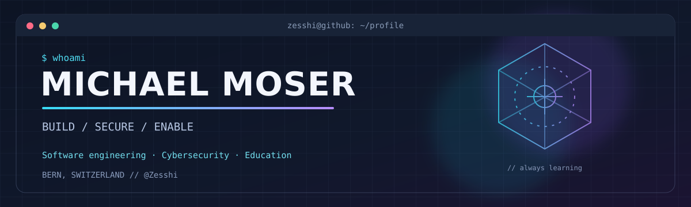

<!-- Profile README for github.com/Zesshi. Keep assets/banner.svg committed alongside this file. -->

<div align="center">
  

  <br />

  <a href="https://github.com/Zesshi?tab=repositories"></a>
  <a href="https://github.com/Zesshi?tab=followers"></a>
  
</div>

<br />

### `> hello_world`

I'm **Michael**, an IT Coach at **Swiss Post**, a full-stack developer, and a **Cyber Security Specialist with a Swiss Federal Diploma**.

I build software, explore how to secure it, and help the next generation of developers understand what's happening under the hood. My interests sit at the intersection of **software engineering**, **security operations**, and **hands-on technical education**.

- **Build** — Java / Spring Boot backends, React / Next.js frontends, APIs and practical tools.
- **Secure** — Threat detection, SIEM / SOAR, identity, incident response and application security.
- **Enable** — Teaching programming, Git, infrastructure and problem-solving through real projects.

---

### `> featured_projects`

<table>
<tr>
<td width="50%" valign="top">

#### [Shiny Tracker](https://github.com/Zesshi/Shiny-Tracker)

A tracker for Pokémon shiny collecting. A personal web project where interface design and practical functionality meet.

`TypeScript` · `Web application`

</td>
<td width="50%" valign="top">

#### [BetterNassi](https://github.com/Zesshi/BetterNassi)

A project centred around Nassi–Shneiderman diagrams and structured programming concepts.

`TypeScript` · `Developer tooling`

</td>
</tr>
<tr>
<td width="50%" valign="top">

#### [Cyber4CH — Backend](https://github.com/Zesshi/ICT-Campus-Cyber4CH-Backend-Fallstudie)

Backend code from an ICT-Campus cybersecurity case-study project.

`Java` · `Backend`

</td>
<td width="50%" valign="top">

#### [Cyber4CH — Frontend](https://github.com/Zesshi/ICT-Campus-Cyber4CH-Frontend-Fallstudie)

The companion frontend for the Cyber4CH case study.

`JavaScript` · `Frontend`

</td>
</tr>
</table>

<details>
<summary><b>More engineering work: HackTheInka</b></summary>
<br />

A team-based Python puzzle platform built with **Java 21, Spring Boot, Next.js, MySQL and WebSockets**. It includes team progress, authentication, live leaderboards and administration features. The deployment work spans **Azure App Service**, separate deployment slots and **GitHub Actions**.

*Described here as engineering experience rather than linked as a public repository.*

</details>

---

### `> toolkit`

**Languages & core development**


**Frameworks & data**


**Cloud, delivery & security**


---

### `> credentials`

| Qualification | Area |
| :-- | :-- |
| **Cyber Security Specialist — Swiss Federal Diploma** | Cybersecurity |
| **CompTIA Security+** | Security fundamentals |
| **Microsoft Certified: Azure Fundamentals (AZ-900)** | Cloud |
| **Microsoft Certified: Azure AI Fundamentals (AI-900)** | Cloud & AI |
| **SVEB Certified Trainer** | Adult education |
| **Application Developer — Swiss Federal VET Diploma** | Software engineering |

---

### `> currently_exploring`

```text
[ SECURITY ]  Threat detection · SIEM / SOAR · Incident response
[ ENGINEER ]  Secure software · Cloud infrastructure · DevSecOps
[ EDUCATE  ]  Better ways to teach through hands-on challenges
```

### `> outside_the_terminal`

Gaming · Motorcycles · Hack The Box · Cooking

<div align="center">
  <br />
  <sub><code>BUILD // SECURE // ENABLE // REPEAT</code></sub>
  <br /><br />
  <a href="https://github.com/Zesshi?tab=repositories">Explore the repositories ↗</a>
</div>
